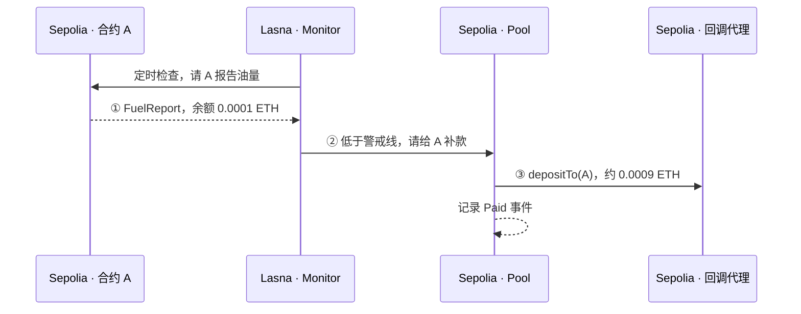

# 给合约自动补 Gas 的资金池

个人开发者可以把 Sepolia ETH 集中存进一个资金池（Pool），让 Lasna 上的 Monitor 轮流检查三个业务合约的“油箱”。油箱是每个合约在 Sepolia 回调代理名下的预付手续费余额。业务可以独立运行，监控可以单独暂停。

## 第一条完整链路

第 1 轮检查中，合约 A 报告油箱里有 **0.0001 Sepolia ETH**，低于 **0.0002 ETH** 的警戒线。Monitor 请求 Pool 给 A 补款，Pool 复核后实际拨入约 **0.0009 ETH**。三笔交易对应同一轮、同一个 A。

| 顺序 | 网络 | 发生了什么 | 交易证据 |
| --- | --- | --- | --- |
| 1 | Sepolia | A 发出 FuelReport，报告预付余额与欠费 | [源链事件](https://sepolia.etherscan.io/tx/0x046f29c715a1f21471a9b38d749da0b86436e732ee9b0d643167cd28437c26b4) |
| 2 | Reactive Lasna | Monitor 的 react() 判断余额偏低，通过 requestCallbackV_1_0 请求拨款 | [Reactive 判断](https://lasna.reactscan.net/tx/0xe0b9ed614d09cd763a2cf7816c8bbb5836475bb81872e83087ebec848f538b98) |
| 3 | Sepolia | Pool 把 ETH 存入 A 的代理预付账户，发出 Paid | [目标链补款](https://sepolia.etherscan.io/tx/0x2c6bc4c3a59c414e23bb7ebfc96db8f0bfdf59b9326cf1aacdae3c36b4614a74) |

### 时序图



## 测试网部署

| 网络 | 合约 | 地址 |
| --- | --- | --- |
| Reactive Lasna | Monitor | `0x5a4f577FD411EE8c90fd2482EbD98eAA02ee5006` |
| Ethereum Sepolia | Pool · 资金池 | `0xF86999E110B49b95D6aE1E7aeC17EE6BC4d8A547` |
| Ethereum Sepolia | A · 合计 | `0x75e02cf483016ee95f3DF7AeB862c6798Bf5b2f3` |
| Ethereum Sepolia | B · 审核 | `0x429b71c279a02E17A16C474386A69Cd68bc53ADd` |
| Ethereum Sepolia | C · 回执 | `0x791abaf1647bAC2bD5aD1309D0CaD7d2744d442E` |

演示结束后已暂停 Monitor，链上读回 active=false。[暂停交易](https://lasna.reactscan.net/tx/0x94053815cd0d060e0a9f3f1cda11a807a5f9a0cc6f2fa2144b4669bbe464eb07)

## 出问题怎么办

本节适用于新版 FuelBank 和 IndependentMonitor。Sepolia 的 Pool 用自己的 ETH 给 A、B、C 的回调账户补款，也能给自己的回调账户存手续费。每次处理有效拨款指令时，Pool 先检查自己的预付余额。余额低于 0.0002 ETH 或存在欠费时触发，自补每次最多 0.0003 ETH，累计最多 0.001 ETH。共用本金，给自己补费会减少可拨给业务的金额。这些上限针对主动充值；网络执行费用按实际收取。

- **防误触与重复。** 只处理指定链和合约的事件。银行校验回调代理、Monitor、三个指定收款对象和轮次，付款前再次检查余额与欠款。重复轮次不能再付款。每个对象单笔和累计最多 0.001 ETH，三个对象累计最多 0.003 ETH。
- **资金池见底。** Pool 最多付出现有余额。处理拨款后如果本金为零，会发出 BankEmpty 事件，Lasna 收到后自动暂停。往 Pool 地址转 Sepolia ETH，再由所有者调用 Monitor 的 resume。充值保留已用额度；16 次请求的硬上限也保留。
- **费用见底。** 如果 Pool 的回调本身已无法送达，任何人可在 Sepolia 主动调用 Pool 的 maintainFeeReserve()；发起人付这笔交易费，资金只能进 Pool 自己的代理账户。自补预算用完后可以直接在代理调用 depositTo(Pool地址) 手动预付。Lasna 的 Monitor 单独使用 lREACT，需要在 Lasna 补充。
- **目标链交易失败。** 回滚会撤销这次交易内的付款和记账。对象三分钟未报告，下次定时事件会请求银行复核；余额够就跳过。银行回调若失败，先看目标链内部调用，再检查累计拨款、代理预付和欠费。旧版一次检查三个对象曾耗尽单笔 gas，增加存款无法提高交易 gas 上限。新版每笔只处理一个对象。可用 stop 暂停后排查。

## 项目目录

[真实项目](真实项目/) 是独立的 Foundry 工程。[IndependentMonitor.sol](真实项目/src/gas-pool/IndependentMonitor.sol) 包含 Lasna 的监控合约和 Sepolia 的资金池。[ExpenseStepsV2.sol](真实项目/src/gas-pool/ExpenseStepsV2.sol) 包含 A、B、C 三个业务合约和共用的油量报告接口。[测试](真实项目/test/IndependentMonitor.t.sol) 使用本地模拟代理和事件系统。[部署脚本](真实项目/script/fuel-pool-v2.sh) 负责部署、启动、暂停和查询。共学记录保存在 [logs](logs/) 和 [notes](notes/)。

## 安装与本地验证

在 Linux 或 Ubuntu WSL 的 Bash 中准备 Git 和 Foundry（开发环境使用 1.9.0，编译器为 Solidity 0.8.29）。[Foundry 安装说明](https://getfoundry.sh/introduction/installation/)

```bash
git clone --recurse-submodules https://github.com/wxu43717-collab/reactive-builder-camp-learning.git
cd reactive-builder-camp-learning/真实项目
forge test -vv
```

预期看到 8 个测试通过，包括正常补款、错误调用被拒、重复报告和预算耗尽。首次编译需要下载编译器。已有仓库可以运行 `git submodule update --init --recursive` 补齐依赖。

## 在自己的测试钱包复现

以下命令均在上面的工程目录运行。准备同一地址的 Lasna lREACT 和 Sepolia ETH。脚本给 Monitor 存入 0.5 lREACT，给 Pool 存入 0.003 Sepolia ETH 本金，并为 Pool、A、B、C 合计预付 0.0033 Sepolia ETH；两条链还需留出交易费。

```bash
export FUEL_ACCOUNT=fuel-demo
export SEPOLIA_RPC_URL=https://rpc.sepolia.ethpandaops.io
# 首次在本机使用这个账户时，交互式导入自己的测试钱包
cast wallet import "$FUEL_ACCOUNT" --interactive
bash script/fuel-pool-v2.sh deploy
bash script/fuel-pool-v2.sh start
bash script/fuel-pool-v2.sh status
```

部署脚本按 Monitor、A、B、C、Pool 的顺序创建合约并保存地址到本机 broadcast/fuel-bank-v2/。启动后每个对象初始预付 0.0001 ETH。等待定时事件和跨链投递，再运行 status。看 A 对应的 Cumulative bank payment（单位 wei）是否大于零，并核对 Pool 的 Paid 事件。完成演示后运行：

```bash
bash script/fuel-pool-v2.sh pause
bash script/fuel-pool-v2.sh status
```

开关应显示 Active: false。要单独演示报销业务，运行 `bash script/fuel-pool-v2.sh order 1200 800 2500`，再运行 `bash script/fuel-pool-v2.sh run`。这张演示单由钱包支付业务交易费，监控可以保持暂停。
