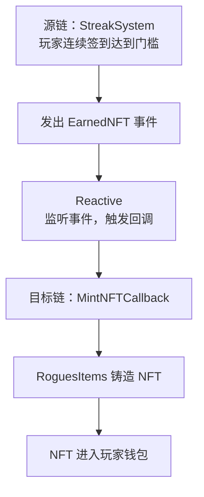

# Reactive 用例拆解：World of Rogues

## 1. 监听哪条链、哪个合约的什么事件？

监听游戏源链上的 `StreakSystem` 智能合约发出的 `EarnedNFT` 事件。

这个合约主要负责玩家的每日签到、连续签到次数和奖励资格判断。这些基本上就是普通游戏里常见的签到系统。

这里以测试网版本为例，源链是 Reactive Kopli。

## 2. 满足什么条件时触发？

当玩家连续签到次数达到预设的 NFT 奖励门槛时，`StreakSystem` 就会发出 `EarnedNFT` 事件。

Reactive 监听到这个事件，就会自动启动后续的 NFT 发放流程。

## 3. 在哪条链做什么动作？

源链负责记录玩家的签到状态，判断玩家是否获得 NFT 资格。

Reactive 监听到事件后，通过回调通知目标链上的 `MintNFTCallback` 合约，再由 `RoguesItems` 合约铸造 NFT，直接发到玩家的钱包地址。

测试网版本的目标链是 Ethereum Sepolia。

## 4. 如果不用 Reactive，怎么做？代价是什么？

如果不用 Reactive，我可以用 Python 写一个自动化程序，持续监听源链上的事件。一旦发现玩家获得 NFT 资格，就向目标链发送交易，调用 NFT 铸造合约。

但这样需要自己维护服务器、监听程序和钱包，管理成本更高，也更加依赖中心化的链下服务。

Reactive 把这套自动监听和执行机制交给区块链网络处理，不需要自己运行机器人。代价是仍然需要支付 Gas 和回调费用。

不过我觉得还有一个问题：**为什么一定要分成两条链？**

如果签到判断和 NFT 铸造都在同一条链上，完全可以直接调用 NFT 合约。这样甚至可能比使用 Reactive 更简单。所以 Reactive 更适合需要事件自动化、模块分离或者跨链交互的场景。

## 流程图

